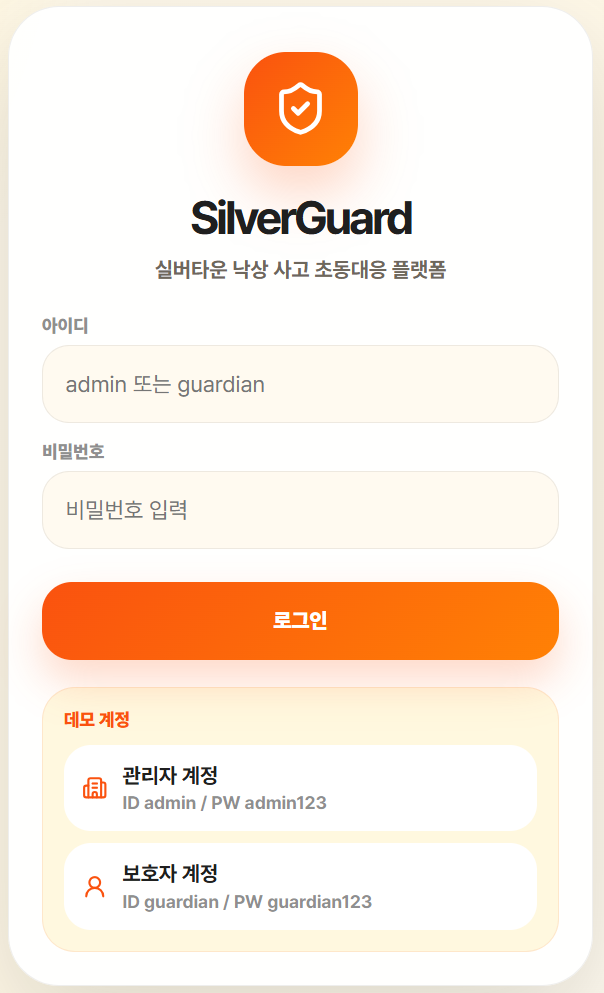
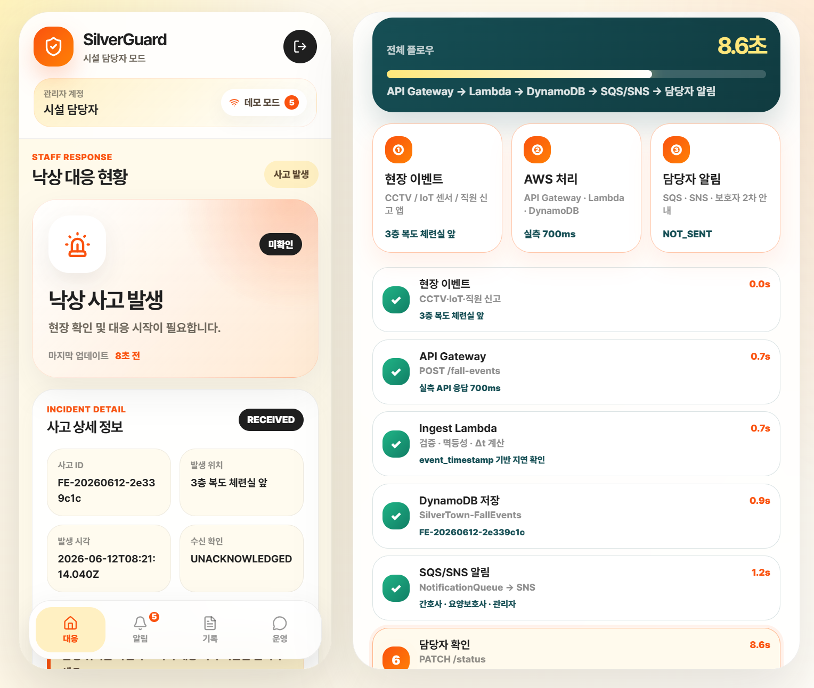
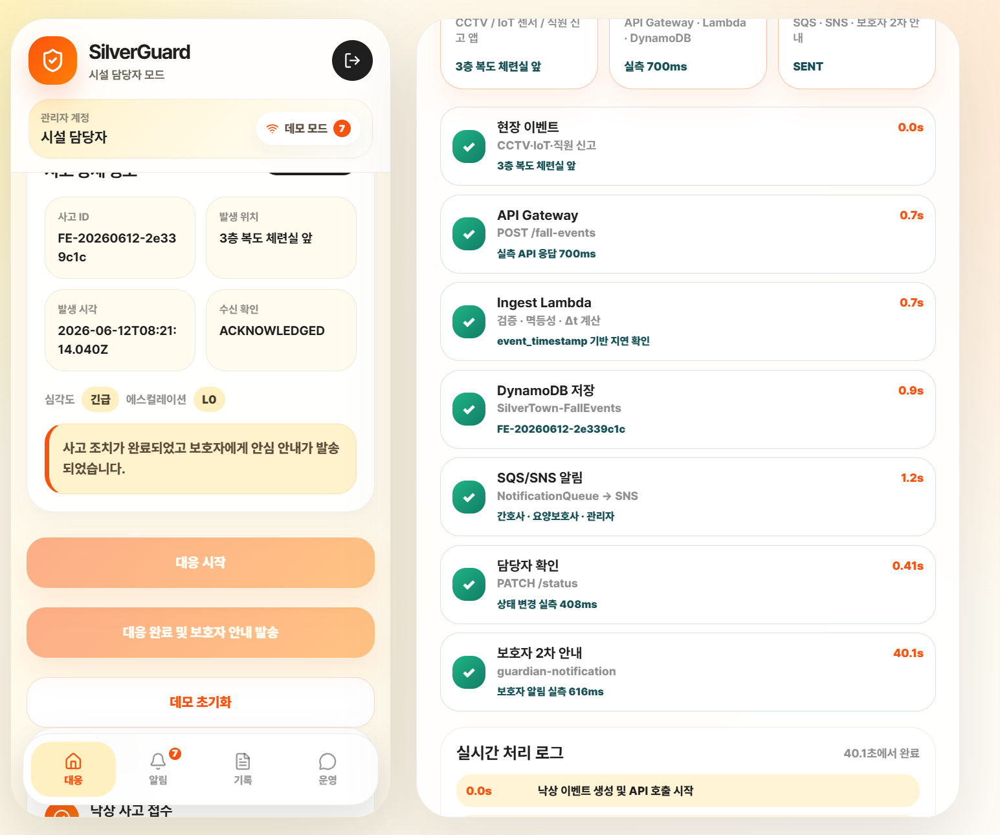
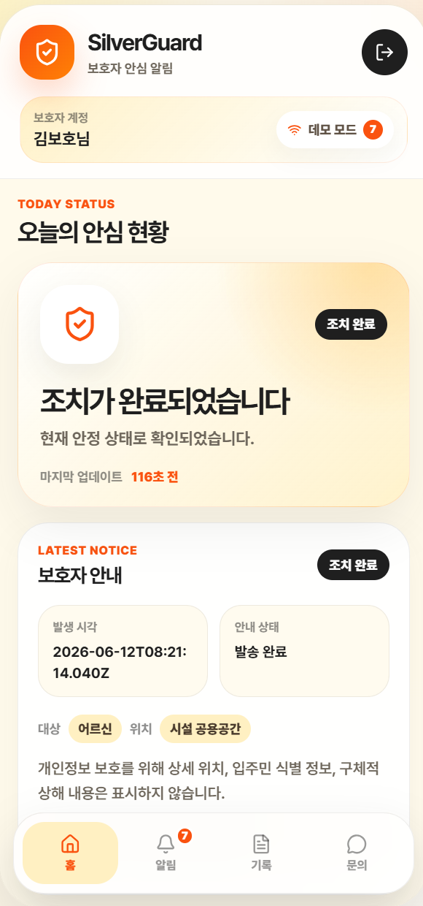
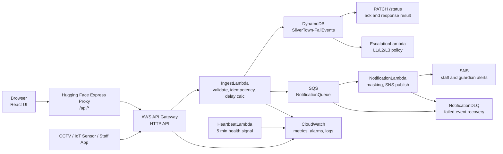

# SilverGuard Guardian

실버타운 낙상 사고가 발생했을 때 사고 접수, 담당자 대응, 보호자 안내까지 이어지는 초동대응 흐름을 시연하는 서버리스 기반 웹 애플리케이션입니다.

이 저장소는 단순 화면 구현이 아니라 **React 프론트엔드 + Express 프록시 + AWS Serverless API 연동 + Hugging Face Docker 배포**까지 포함한 포트폴리오용 프로젝트입니다.

## Live Demo

- Hugging Face Space: [ukss/SeniorSafety](https://huggingface.co/spaces/ukss/SeniorSafety)
- GitHub Repository: [Jaeukss/silverguard-guardian-docker](https://github.com/Jaeukss/silverguard-guardian-docker)

## Problem

실버타운 야간 근무자는 적은 인원으로 다수의 입주민을 담당합니다. 낙상 사고가 발생하면 담당자가 환자 곁을 떠나 전화나 무전으로 상황을 전파해야 하고, 사고 기록도 수기로 남겨야 합니다.

이 프로젝트에서는 다음 문제를 해결 대상으로 잡았습니다.

- 기존 전파 시간: 약 14분
- 수기 사고 기록: 평균 15분
- 목표 전파 시간: 3초 이내
- 목표 기록 방식: 사고 접수와 조치 상태 자동 저장

## My Role

PM과 AWS 구현을 담당했습니다.

- 문제 정의와 요구사항 우선순위 정리
- MoSCoW 기반 MVP 범위 설정
- 5개 HTTP API 흐름 정의
- API Gateway, Lambda, DynamoDB, SQS, SNS, CloudWatch 기반 서버리스 구조 구현
- Hugging Face Docker Space 배포
- 데모 화면과 실시간 처리 흐름 검증

## Demo Screenshots

| Login | Incident Flow |
| --- | --- |
|  |  |

| Completed Response | Guardian View |
| --- | --- |
|  |  |

전체 스크린샷은 [screenshots](screenshots/)에서 확인할 수 있습니다.

## Architecture



## Core Flow

1. 관리자 또는 센서가 낙상 이벤트를 생성합니다.
2. Express 프록시가 `/api/fall-events` 요청을 AWS API로 전달합니다.
3. `IngestLambda`가 필수값, 멱등키, 감지 지연을 확인합니다.
4. 사고 이력이 `DynamoDB`에 `RECEIVED` 상태로 저장됩니다.
5. `SQS NotificationQueue`가 알림 요청을 비동기로 완충합니다.
6. `NotificationLambda`가 SNS를 통해 담당자에게 알림을 보냅니다.
7. 관리자가 `IN_PROGRESS`, `COMPLETED` 상태로 조치 결과를 갱신합니다.
8. 조치 완료 후 보호자에게 2차 안심 안내를 발송합니다.

## API

| Method | Path | Purpose |
| --- | --- | --- |
| `POST` | `/fall-events` | 낙상 사고 신규 접수 |
| `GET` | `/fall-events` | 전체 사고 목록 조회 |
| `GET` | `/fall-events/:eventId` | 특정 사고 상세 조회 |
| `PATCH` | `/fall-events/:eventId/status` | 담당자 조치 상태 업데이트 |
| `POST` | `/fall-events/:eventId/guardian-notification` | 보호자 2차 안내 발송 |

프론트엔드는 AWS API를 직접 호출하지 않고 Express 서버의 `/api/*` 경로만 호출합니다. API Key는 브라우저에 노출하지 않고 서버 환경변수로만 주입합니다.

## Tech Stack

| Area | Stack |
| --- | --- |
| Frontend | React, Vite, lucide-react |
| Proxy Server | Express |
| Deployment | Docker, Hugging Face Spaces Docker SDK |
| AWS Backend | API Gateway, Lambda, DynamoDB, SQS, SNS, CloudWatch, DLQ, EventBridge |
| Observability | CloudWatch Metrics, Logs, Alarms, Heartbeat |

## Technical Highlights

### Serverless Event Pipeline

낙상 이벤트는 짧고 간헐적으로 발생하는 요청이므로 EC2 상시 운영보다 Lambda 중심 구조가 적합하다고 판단했습니다. API Gateway와 Lambda로 요청을 받고, SQS로 알림 폭주를 완충하고, DLQ로 실패 이벤트를 격리하는 구조를 사용했습니다.

### State-Oriented Incident Tracking

사고 상태는 단순 로그가 아니라 처리 상태로 관리합니다.

```text
RECEIVED -> IN_PROGRESS -> COMPLETED -> ESCALATED
```

담당자 확인은 `ack_status`, `ack_at`, `actionResult`로 분리해 저장합니다. 이 구조 덕분에 관리자 화면에서는 처리 진행 상황을 보고, 보호자 화면에서는 조치 완료 여부만 간결하게 볼 수 있습니다.

### Data Model for Operations

`SilverTown-FallEvents` 테이블은 사고 이력 저장뿐 아니라 운영 조회까지 고려했습니다.

- `eventId`: 사고 고유 ID
- `detectedAt`: API 접수 시각
- `event_timestamp`: 센서 감지 시각
- `status`: 사고 처리 상태
- `ack_status`: 담당자 확인 여부
- `escalation_level`: L0~L3 경보 단계

조회 패턴은 GSI로 분리했습니다.

- `status + detectedAt`: 미해결 사고 조회
- `residentId + detectedAt`: 입주민별 과거 이력 조회
- `event_timestamp + detectedAt`: 감지 지연 분석

### Observability Criteria

CloudWatch 지표를 전부 보는 대신 운영자가 바로 판단할 수 있는 기준으로 줄였습니다.

| Category | Metric | Threshold |
| --- | --- | --- |
| Latency | API Gateway Latency, Lambda Duration | p95 3초 초과 |
| Detection Delay | `DetectionDelayDeltaSeconds` | 10초 초과 |
| Error Rate | `5XXError` | 1% 초과 |
| Queue Failure | NotificationDLQ | 1건 이상 |
| Notification Failure | SNS Failed | 1건 이상 |
| Health Check | HeartbeatSuccess | 10분 미수신 |

## Demo Results

| Metric | Result |
| --- | --- |
| API Gateway response in demo | 약 700ms |
| Guardian notification request in demo | 약 616ms |
| Manual incident record target | 15분 -> 0분 자동 기록 |
| Alert propagation target | 14분 -> 3초 이내 |
| Target monthly cost | EC2 월 $50 대비 서버리스 월 $5 내외 |

데모 화면의 전체 완료 시간 `40.1초`는 담당자가 대응 시작과 완료 버튼을 누르는 시간이 포함된 end-to-end 시연 시간입니다. 시스템 API 응답 시간과는 분리해서 봅니다.

## Security

- API Key는 프론트엔드에 저장하지 않습니다.
- Express 프록시가 서버 환경변수의 `API_KEY`를 읽어 `x-api-key` 헤더로 전달합니다.
- 보호자 알림에는 상세 위치, 주민 식별 정보, 구체적 상해 내용을 노출하지 않는 방향으로 설계했습니다.
- 알림 발송 전 민감정보 마스킹을 적용하는 구조를 사용했습니다.

## Environment Variables

Hugging Face Space 또는 로컬 실행 환경에 다음 값을 설정합니다.

```env
API_BASE_URL=https://your-api.example.com
API_KEY=your-api-key
```

`API_KEY`가 필요한 AWS 백엔드라면 반드시 secret으로 등록합니다. README, Git 커밋, 프론트엔드 코드에는 실제 값을 저장하지 않습니다.

## Local Development

```bash
npm install
npm run dev
```

기본 개발 서버는 `http://localhost:7860`입니다.

## Production Build

```bash
npm install
npm run build
npm run start
```

## Docker

```bash
docker build -t silverguard-guardian .
docker run --rm -p 7860:7860 \
  -e API_BASE_URL=https://your-api.example.com \
  -e API_KEY=your-api-key \
  silverguard-guardian
```

Windows PowerShell:

```powershell
docker build -t silverguard-guardian .
docker run --rm -p 7860:7860 `
  -e API_BASE_URL="https://your-api.example.com" `
  -e API_KEY="your-api-key" `
  silverguard-guardian
```

## Demo Accounts

| Role | ID | Password |
| --- | --- | --- |
| Admin | `admin` | `admin123` |
| Guardian | `guardian` | `guardian123` |

## Retrospective

PM과 AWS 구현 과정에서 정리한 회고는 [docs/pm-aws-retrospective.md](docs/pm-aws-retrospective.md)에 정리했습니다.

## Project Notes

- 이 프로젝트는 낙상 감지 AI 자체를 구현한 것이 아니라, 감지 이벤트 이후의 접수, 전파, 기록, 보호자 안내 흐름을 자동화한 PoC입니다.
- 현재 버전은 API Key 기반이며, 실서비스에서는 Cognito JWT 기반 역할별 접근 제어가 필요합니다.
- CI/CD, 멀티테넌트, 오탐 필터링, QuickSight 통계 대시보드는 후속 개선 항목입니다.
